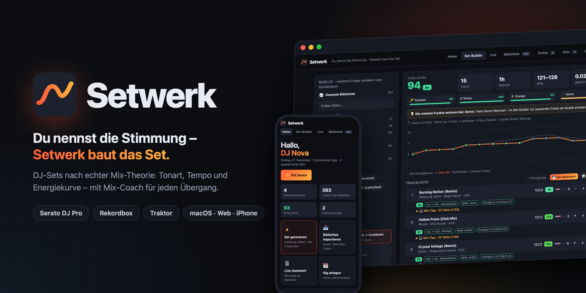
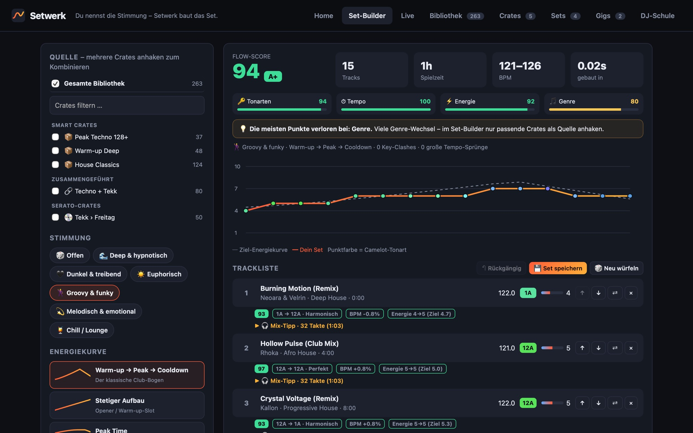
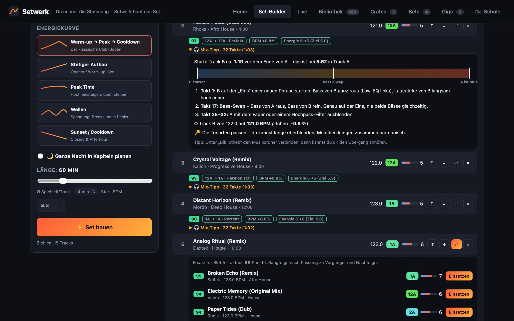
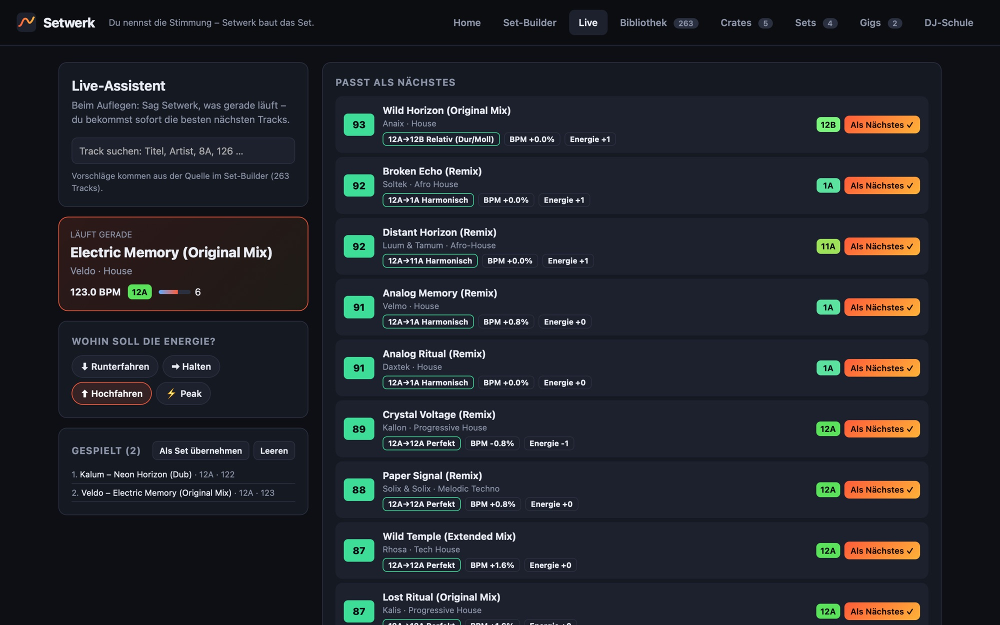
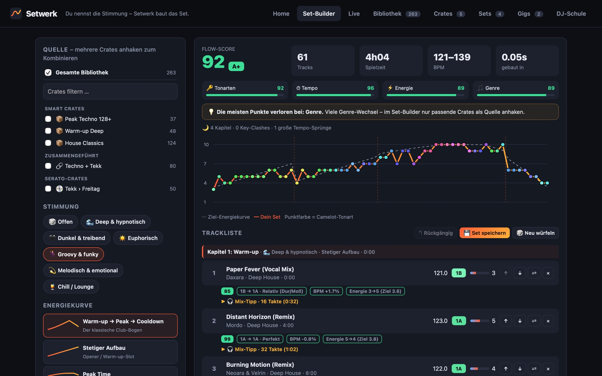
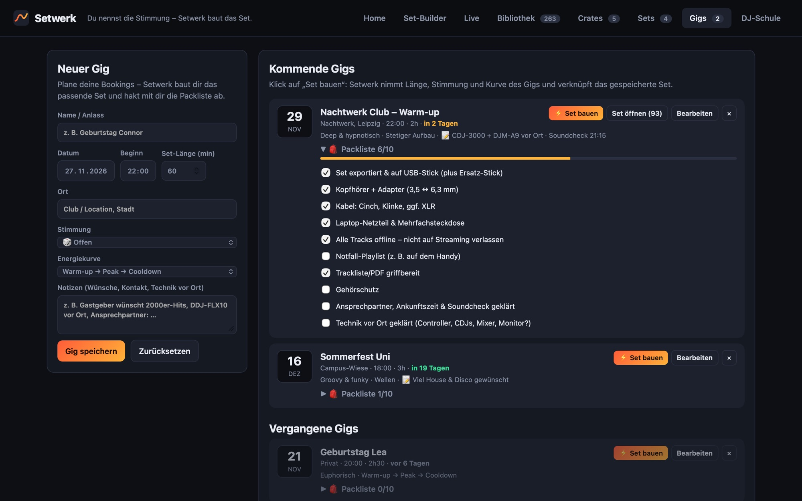
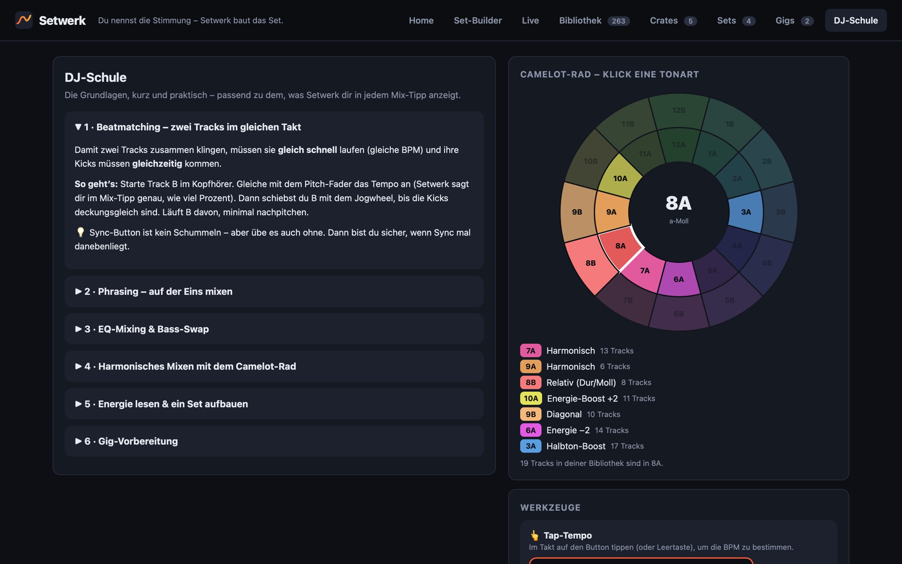
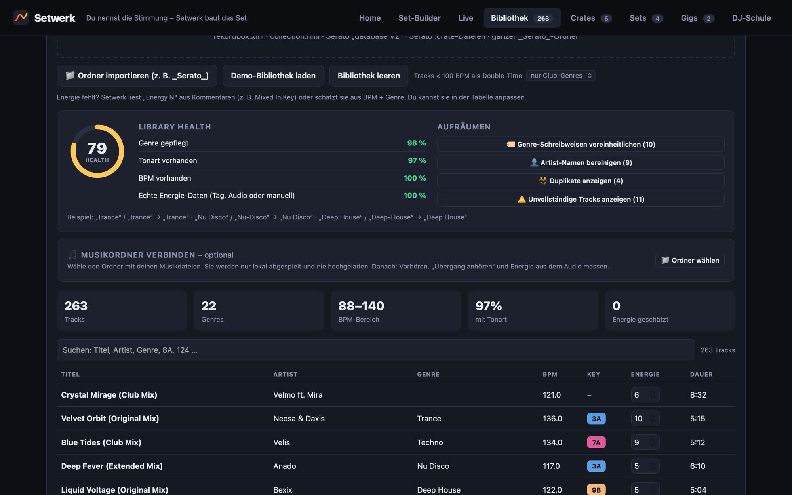
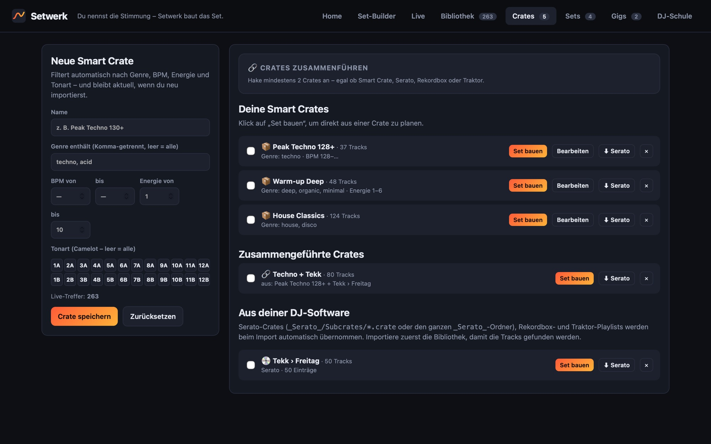

<p align="center">
  
</p>

<p align="center">
  <a href="https://zthsydnhbt-hub.github.io/setwerk/"></a>
  <a href="https://zthsydnhbt-hub.github.io/setwerk/app/"></a>
  <a href="https://github.com/zthsydnhbt-hub/setwerk/releases/latest"></a>
  <a href="https://github.com/zthsydnhbt-hub/setwerk/releases"></a>
</p>

<h3 align="center">DJ-Sets nach echter Mix-Theorie – für Mac, Web und iPhone.</h3>

<p align="center"><a href="https://zthsydnhbt-hub.github.io/setwerk/"><b>🌐 zthsydnhbt-hub.github.io/setwerk</b></a></p>

<p align="center">
Setwerk plant DJ-Sets aus deiner <b>Serato-, Rekordbox- oder Traktor-Bibliothek</b>: passende Tonarten, saubere Tempos und eine Energiekurve, die zum Abend passt.<br>
Mit <b>Mix-Coach</b> für jeden Übergang, <b>Live-Assistent</b> und <b>DJ-Schule</b> – ideal für Einsteiger, schnell genug für Profis.
</p>

<p align="center"><b>Kostenlos · Ohne Anmeldung · Deine Daten bleiben auf deinem Gerät</b></p>

---

## ⬇️ Download & Installation

> **Die ausführliche Anleitung mit Bildern findest du hier: [zthsydnhbt-hub.github.io/setwerk](https://zthsydnhbt-hub.github.io/setwerk/#download)**

| Gerät | Download | Kurz-Anleitung |
|---|---|---|
| 🍎 **Mac** (empfohlen) | [**Setwerk-macOS.pkg**](https://github.com/zthsydnhbt-hub/setwerk/releases/latest/download/Setwerk-macOS.pkg) | Installer öffnen, durchklicken, fertig |
| 🍎 Mac (Alternative) | [Setwerk-macOS.dmg](https://github.com/zthsydnhbt-hub/setwerk/releases/latest/download/Setwerk-macOS.dmg) | Setwerk auf „Programme“ ziehen |
| 📱 iPhone & iPad | [Web-App öffnen](https://zthsydnhbt-hub.github.io/setwerk/app/) | Safari → Teilen → „Zum Home-Bildschirm“ |
| 🌐 Windows, Android, Linux | [Web-App öffnen](https://zthsydnhbt-hub.github.io/setwerk/app/) | In Chrome/Edge auf „App installieren“ |

### 🍎 Mac in 4 Schritten

**1. Installer herunterladen**: [**Setwerk-macOS.pkg**](https://github.com/zthsydnhbt-hub/setwerk/releases/latest/download/Setwerk-macOS.pkg) (ca. 230 KB, macOS 13 oder neuer, Apple Silicon & Intel).

**2. Doppelklick auf die Datei.** macOS zeigt beim ersten Mal *„Setwerk-macOS.pkg wurde nicht geöffnet“*. **Das ist normal**: Klick auf **„Fertig“**.

**3. Öffnen erlauben:** ** Menü → Systemeinstellungen → Datenschutz & Sicherheit**, ganz nach unten scrollen und bei Setwerk auf **„Trotzdem öffnen“** klicken. Mit Passwort oder Touch ID bestätigen.

**4. Installer durchklicken:** *Fortfahren → Installieren*. Setwerk liegt jetzt in **Programme** und startet ab sofort ohne Warnung.

> [!NOTE]
> **Warum warnt macOS?** Apple zeigt die Meldung bei jeder App, die nicht über ein kostenpflichtiges Apple-Entwicklerkonto beglaubigt wurde. Setwerk ist quelloffen: Der komplette Code steht in diesem Repository. Die App sendet keine Daten.
>
> Profis können die Sperre bei der DMG-Version auch per Terminal aufheben: `xattr -dr com.apple.quarantine /Applications/Setwerk.app`

---

## ✨ Funktionen

<table>
<tr>
<td width="50%"><br><b>⚡ Set in Sekunden.</b> Stimmung, Energiekurve und Länge wählen. Setwerk baut das Set und bewertet es (0–100) nach Tonarten, Tempo, Energie und Genre.</td>
<td width="50%"><br><b>🎧 Mix-Coach.</b> Für jeden Übergang: Startpunkt, Pitch, Bass-Swap im richtigen Takt, Hinweise zur Tonart. Zum Anhören, tempo-angepasst. Dazu 3 Ersatz-Tracks pro Slot.</td>
</tr>
<tr>
<td><br><b>🎚️ Live-Assistent.</b> Was passt als Nächstes? Sag, ob die Energie hoch, gleich oder runter soll, und du bekommst sofort die besten Tracks.</td>
<td><br><b>🌙 Ganze Nacht planen.</b> Kapitel wie Warm-up, Peak und Closing mit eigener Stimmung. Vorlagen für Club, Party, Bar und Festival.</td>
</tr>
<tr>
<td><br><b>📅 Gigs & Packliste.</b> Termine planen, mit einem Klick das passende Set bauen und vor dem Gig die Packliste abhaken.</td>
<td><br><b>🎓 DJ-Schule.</b> Beatmatching, Phrasing, EQ-Mixing, interaktives Camelot-Rad, Tap-Tempo und Pitch-Rechner.</td>
</tr>
<tr>
<td><br><b>🩺 Library Health.</b> Findet Duplikate, fehlende Tonarten und unordentliche Genres und räumt mit einem Klick auf.</td>
<td><br><b>📦 Crates.</b> Smart Crates nach Genre, BPM, Energie und Tonart. Serato-, Rekordbox- und Traktor-Crates übernehmen und zusammenführen.</td>
</tr>
</table>

**Außerdem:** Musikordner verbinden für Vorhören und Energie-Messung direkt aus dem Audio · Sets speichern mit Verlauf · Export als **Serato-Crate, Rekordbox-XML, M3U8** und **PDF-Trackliste** mit eigenem Branding · funktioniert offline.

## 🎛️ Unterstützte DJ-Software

| | Import | Export |
|---|---|---|
| **Serato DJ Pro** | `database V2`, `.crate`-Dateien oder der ganze `_Serato_`-Ordner | Serato-Crate (`.crate`) |
| **Rekordbox** | Collection-XML inkl. Playlists | Rekordbox-XML mit Playlist |
| **Traktor** | `collection.nml` inkl. Playlists | M3U8 |
| **Mixed In Key** | Energie-Werte aus den Kommentaren | – |

## 🔒 Datenschutz

Setwerk speichert deine Bibliothek, Crates, Sets und Gigs **nur auf deinem Gerät**. Es gibt keine Anmeldung und keine Cloud, und deine Musik wird nirgendwo hochgeladen.

## 🛠️ Selbst bauen

```bash
./mac/build.sh 1.1.0
```

Erzeugt `Setwerk.app`, `Setwerk-macOS.dmg` und `Setwerk-macOS.pkg` (benötigt die Xcode Command Line Tools). Die Web-App liegt in `app/` (`index.html`, `extra.js`) und läuft ohne Build-Schritt. Die Website (Vorstellung & Download) ist `index.html` im Hauptordner.
